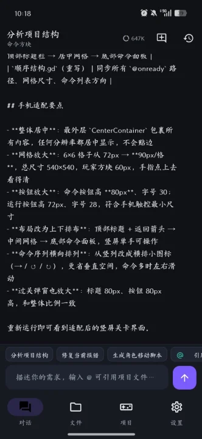
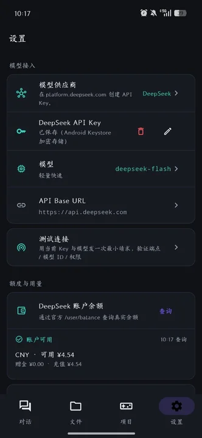

# GDAM · Godot Dev Agent Mobile

[](https://flutter.dev)
[](https://dart.dev)
[](https://developer.android.com)
[](https://godotengine.org)
[](LICENSE)

在安卓手机端以自然语言驱动 **Godot 4** 项目开发的 AI Agent。支持
**DeepSeek** 与 **火山方舟（豆包 Doubao-Seed-2.1-pro）** 两家 OpenAI 兼容接口，
通过 Function Calling 让模型直接读写你手机上的 Godot 项目文件，跑通
「自然语言提需求 → AI 写代码 → 手机端 Godot 预览运行」的移动开发闭环。

## 📱 应用截图






---

## 功能一览

| 模块 | 能力 |
| --- | --- |
| 对话 | 多会话、按项目分组、历史本地持久化、流式输出、中途停止、切后台不丢进度 |
| 模型 | DeepSeek / 火山方舟双供应商切换，各自的 Key、模型、端点互不污染 |
| 额度 | DeepSeek 查真实余额；豆包用 IAM AK/SK 查各模型免费额度余量 |
| 用量 | 每轮 `usage` 累加：会话级 token 计数 + 本机按模型分组的累计统计 |
| 思考链 | `reasoning_content` 折叠展示；方舟的加密思考块 `encrypted_content` 自动回传 |
| 工具调用 | 工具名 / 参数 / 状态 / 结果全程可视化，可展开查看原始返回 |
| Skill | Markdown 规则文件，内置 3 个 + 项目级 `.gdam/skills/*.md`，按需加载 |
| 文件 | 目录授权、文件树浏览、`.gd` GDScript 高亮编辑、一键写入、备份回滚 |
| 安全 | 写文件前弹 Diff 预览（逐行 +/-），确认后才落盘；原文件自动备份 |
| 引用 | 输入框支持 `@文件名` 快捷引用，把文件内容注入上下文 |
| 设置 | API Key（Keystore 加密，按供应商隔离）、模型、连通性自检、温度、备份开关 |

### 内置工具（7 个）

| 工具 | 作用 | 风险 |
| --- | --- | --- |
| `list_directory` | 列出项目目录树 | 低（免确认） |
| `read_file` | 读取文件完整内容 | 低（免确认） |
| `search_code` | 全局关键字搜索，返回 `文件:行号: 内容` | 低（免确认） |
| `parse_scene` | 解析 `.tscn` / `.tres`，输出节点树与外部依赖 | 低（免确认） |
| `load_skill` | 读取指定 Markdown Skill 的全文 | 低（免确认） |
| `edit_file` | 基于原文精确匹配的行级替换（要求唯一匹配） | 中（需确认） |
| `write_file` | 创建 / 整体覆盖文件 | 高（需确认） |

---

## 技术栈

- Flutter 3.47 / Dart 3.13（空安全全开）
- Riverpod 2.6（`Notifier` / `AsyncNotifier`）
- Dio 5 + SSE 流式解析
- `flutter_code_editor` + 手写 GDScript 高亮（highlight.js 里 GDScript 是第三方语言，需自行移植）
- `diff_match_patch`（行级 diff，先做行→字符映射再跑字符级 LCS）
- `shared_preferences`（配置 / 会话 / 用量账本）+ `flutter_secure_storage`（API Key、火山 AK/SK）
- `crypto`（火山管控面 OpenAPI 的 V4 HMAC-SHA256 签名）
- `permission_handler`（`MANAGE_EXTERNAL_STORAGE`）

### 两家供应商的协议差异

两家都是 OpenAI 兼容协议，差异集中在 `lib/core/api/provider_spec.dart` 里集中描述：

| | DeepSeek | 火山方舟（豆包） |
| --- | --- | --- |
| Base URL | `https://api.deepseek.com` | `https://ark.cn-beijing.volces.com/api/v3` |
| 默认模型 | `deepseek-v4-pro` | `doubao-seed-2-1-pro-260915` |
| 模型 ID | 直接用模型名 | **必须带版本后缀**，填短名会自动补全 |
| 输出上限字段 | `max_tokens` | `max_completion_tokens`（思考 token 共用预算） |
| 思考开关 | 无 | `thinking: {"type": "enabled" \| "disabled"}` |
| 思考回传 | 不回传 `reasoning_content` | `encrypted_content` 原样回传，缺省退回明文 |

> **关于豆包模型名**：控制台里的 `Doubao-Seed-2.1-pro` 是展示名，直接下发会
> 404（`InvalidEndpointOrModel.NotFound`）。客户端会归一化成
> `doubao-seed-2-1-pro-260915`，也可以手动填自定义推理接入点 ID（`ep-…`）。
> 设置页的「测试连接」能看到实际下发的模型 ID 与平台原始报错。

---

## 目录结构

```
lib/
├── main.dart                     # 入口：初始化 SharedPreferences + ProviderScope
├── app.dart                      # MaterialApp + GDScript 高亮注册
├── core/
│   ├── api/
│   │   ├── llm_client.dart       # 通用客户端：SSE 流式、thinking、encrypted_content、余额查询
│   │   ├── provider_spec.dart    # 供应商能力描述 + 方舟模型 ID 归一化
│   │   ├── volcengine_client.dart# 火山管控面 V4 签名 + ListModelChargeItems（免费额度）
│   │   └── models/               # ChatMessage / ToolCallRequest / 余额 / 额度 / LlmException
│   ├── usage/
│   │   └── usage_store.dart      # 本机 token 账本（按供应商 + 模型分组）
│   ├── agent/
│   │   ├── base_tool.dart        # BaseTool 抽象 + ToolContext（含 skill 快照）
│   │   ├── tool_registry.dart    # 工具注册，动态生成 OpenAI tools 数组
│   │   ├── agent_runner.dart     # 多轮 Function Calling 调度循环（Agent 核心）
│   │   ├── system_prompt.dart    # 系统提示词（含 skill 清单与激活全文）
│   │   └── tools/                # 7 个内置工具实现
│   ├── skill/
│   │   └── skill.dart            # Markdown frontmatter 解析 + 内置/项目级 skill 加载
│   ├── fs/
│   │   ├── project_fs.dart       # 沙箱路径解析（越权拦截的唯一入口）
│   │   └── backup_service.dart   # .backup 备份 / 保留 3 版 / 回滚
│   ├── storage/                  # SharedPreferences / SecureStore（按 provider 分 key）
│   ├── config/                   # AppSettings（provider + 每 provider 配置）、GodotProject
│   ├── providers.dart            # 全部 Riverpod Provider
│   └── theme/ · utils/           # 深色主题、GDScript 高亮定义
├── features/
│   ├── chat/                     # 会话状态机 + 聊天 UI（气泡/思考块/工具卡/输入栏/Skill 选择）
│   ├── diff/                     # 行级 diff + 高危操作确认弹窗
│   ├── files/                    # 文件树、编辑器、目录选择器、@引用面板
│   ├── projects/                 # 项目关联与切换、存储权限
│   ├── settings/                 # 设置页（模型接入 / 额度用量 / Skill / 安全 / 数据）
│   └── shell/                    # 底部导航壳
assets/skills/                    # 内置 Skill（gdscript-style / scene-build / mobile-perf）
test/core_logic_test.dart         # 50 个单元测试（沙箱/工具/备份/diff/内容解析/供应商/Skill/用量/签名）
```

---

## Skill（Markdown 规则文件）

Skill 是一段可复用的 Markdown 规则，用来把「团队约定」「操作手册」这类知识
从对话里搬到文件里，不用每次重复交代。**不支持 MCP**，只认 `.md` 文件。

### 存放位置

| 来源 | 路径 | 说明 |
| --- | --- | --- |
| 内置 | `assets/skills/*.md` | 随 APK 打包，设置页可启用/禁用 |
| 项目级 | `<项目根>/.gdam/skills/*.md` | 同 id 覆盖内置，只对当前项目生效 |

三种添加方式：

1. 用电脑/文件管理器把 `.md` 放进项目的 `.gdam/skills/` 目录；
2. 设置 → Skill → 「从项目里导入 .md」把项目内已有的 md 复制过去；
3. 直接让 Agent 帮你写：「把这段规范存成 skill」。

### 文件格式

```md
---
name: gdscript-style        # id，缺省用文件名（自动转小写连字符）
title: GDScript 代码风格     # 展示名
description: 写或改 .gd 脚本时套用的命名/缩进/类型约定
---
# 正文：规则、检查清单、示例代码都可以
```

没有 frontmatter 也能用：取第一个 `# 标题` 作 title，第一段正文作 description。

### 渐进披露

系统提示里**只放 skill 的 id + 一句话说明**，全文由模型按需读取：

```
# 可用 Skill
- `gdscript-style`：写或改 .gd 脚本时套用的命名/缩进/类型约定
- `mobile-perf`：目标平台是安卓手机时，按清单检查帧率/内存/发热
```

模型判断当前任务属于某个 skill 的适用范围时，调 `load_skill` 拉全文再执行。
装了 20 个 skill 也不会把上下文撑爆。

聊天输入栏的「Skill」按钮可以**强制本轮加载**：勾选的 skill 全文会直接写进
系统提示，适合「这次一定要按这套规则改」的场景，发送后自动取消。

---

## 额度与用量

### Token 消耗（会话级 + 本机累计）

每次模型调用返回的 `usage` 都会被累加——一次任务里「模型 → 工具 → 模型」往返多少轮，
就记多少轮，不会只算最后一轮。

| 位置 | 内容 |
| --- | --- |
| 聊天页右上角 | 本会话累计 token（`1.2K` 这种紧凑写法），点开看 prompt / completion / 思考 / 调用次数 / 合计 |
| 历史会话抽屉 | 每个会话的 token 数 |
| 设置 → 额度与用量 → 本机累计消耗 | 按「供应商 · 模型」分组的累计，可一键清空 |

统计口径：**只统计本机、只统计 App 发起的请求**，用来判断「哪个模型在吃 token」；
真实扣费与账单请以平台控制台为准。

### DeepSeek 账户余额

用当前填的 `sk-…` 直接调官方 `GET /user/balance`，显示：

- 账户是否可继续调用（`is_available`）；
- 每个币种的「可用总额 / 赠金 / 充值」（金额按平台返回的字符串原样展示）。

### 豆包免费额度（需要 IAM AK/SK）

方舟的免费额度余量在**管控面**，接口是 `ListModelChargeItems`，返回每个模型的
`free_usage { total, consumed, remaining }`。它只能凭 IAM AK/SK + V4 签名调用，
**`ark-…` 推理 Key 会被网关直接拒绝**。配置步骤：

1. 火山引擎控制台 → **访问控制 IAM → 用户 → 密钥管理**，创建 AccessKey ID / Secret AccessKey；
2. 给该用户（或角色）授予方舟的**用量查询**权限，否则接口返回 `AccessDenied`；
3. App → 设置 → 额度与用量 → **火山 IAM AK/SK** 填入（同样存在 Android Keystore）；
4. 点「查询」→ 看到各模型「剩余 / 总量」+ 进度条。

展示细节：

- `remaining` 由服务端算好，**可能为负**（资源包过期降档），此时显示「已超额」而不是 0；
- 剩余不足 20% 变黄、为 0 变红；
- `State` 不是 `Activated` 的模型会提示「未开通」，需要去控制台「开通管理」开通；
- 列表里没出现的模型 = 该账号未开通或不提供免费额度。

> 签名实现（`lib/core/api/volcengine_client.dart`）踩过两个坑，已在单测里锁定：
> RFC3986 里 `! * ' ( )` 必须转义（Dart 的 `Uri.encodeComponent` 不转义），
> 以及 `CanonicalHeaders` 尾换行会让它与 `SignedHeaders` 之间**多出一个空行**。

---

## 构建

```bash
# 1. 依赖
flutter pub get

# 2. 检查
flutter analyze      # 应为 No issues found!
flutter test         # 50 个测试应全部通过

# 3. 打包
flutter build apk --release
# 产物：build/app/outputs/flutter-apk/app-release.apk
```

环境要求：Flutter ≥ 3.24、JDK 17、Android SDK（platform 35 / build-tools 35）。

> 若在国内构建，建议先设置镜像（本仓库的 `android/gradle/wrapper` 与
> `android/build.gradle.kts` 已预置腾讯云 / 阿里云镜像）：
> ```bash
> export PUB_HOSTED_URL=https://pub.flutter-io.cn
> export FLUTTER_STORAGE_BASE_URL=https://storage.flutter-io.cn
> ```

---

## 首次使用

1. **授权目录**：进入「项目」页 → 关联 Godot 项目 → 系统会拉起
   「访问所有文件」设置页，手动开启后返回，再选择包含 `project.godot` 的目录。
2. **选供应商并配置 Key**：进入「设置」页 →
   - 点「模型供应商」选择 DeepSeek 或火山方舟（豆包）；
   - 粘贴对应平台的 API Key（保存在 Android Keystore，两家分开存）：
     - DeepSeek：在 [platform.deepseek.com](https://platform.deepseek.com) 创建；
     - 豆包：在火山方舟控制台「API Key 管理」创建，形如 `ark-…`，
       **不要**用 IAM 的 AK/SK。
   - 点「测试连接」确认端点 / 模型 ID / 权限都通。
4. **（可选）看额度**：设置 → 额度与用量 →
   - DeepSeek：点「查询」直接看余额；
   - 豆包：先填火山 IAM AK/SK（见上文「豆包免费额度」），再点「查询」看各模型剩余免费额度。
   如果模型报「has not activated the model」，说明该模型版本没开通，去控制台开通，
   或在额度列表里挑一个已开通的模型版本填进「设置 → 模型」。
5. **开始对话**：回到「对话」页，直接说需求，例如：
   - `帮我查看项目入口脚本 main.gd 的内容`
   - `帮我在 src 目录下创建一个玩家移动脚本 player.gd`
   - `按 gdscript-style 的规范重构 player.gd`
   - 输入 `@` 可从文件面板引用上下文，点「Skill」可指定本轮启用的 skill。

---

## Agent 运行流程

```
用户输入
  ↓
组装上下文（system prompt + skill 清单/激活全文 + 历史消息 + @引用的文件）
  ↓
POST /chat/completions（stream=true, tools=[7 个工具], tool_choice=auto）
  ↓  SSE 增量
├─ reasoning_content  → 「思考中」折叠块
├─ encrypted_content  → 累积起来，下一轮原样回传（方舟）
├─ content            → 正文流式气泡
└─ tool_calls 分片     → 按 index 累积成完整调用
  ↓
有工具调用？
├─ 否 → 结束，保留最终回答
└─ 是 → 校验路径沙箱 → （中/高危）弹 Diff 确认 → 执行 → 结果作为 role=tool 回喂
        ↓
      回到「调用模型」继续判断（最多 12 轮，防止死循环）
```

### 安全边界

- **路径沙箱**：所有工具只能通过 `ProjectFs.resolve()` 拿绝对路径，任何
  `..` / 绝对路径越权都会在进入 IO 前被拦截，并以「路径越权」回喂给模型自我纠正。
- **写操作确认**：`write_file`（高危）与 `edit_file`（中危）执行前生成改动前后快照，
  弹窗逐行展示 `+/-`，用户点「确认执行」才落盘。
- **自动备份**：写入前把原文件复制到 `<项目根>/.backup/<相对目录>/<文件名>.<时间戳>.bak`，
  每个文件只保留最近 3 个版本；编辑器页可随时回滚。
- **Key 隔离**：两家供应商的 API Key 分开存储，切换供应商不会互相覆盖或泄漏。

---

## 已知限制

- 仅适配 Android（iOS 未做）；`MANAGE_EXTERNAL_STORAGE` 在 Google Play 上架需
  单独提交用途声明。
- 会话历史整包 JSON 存于 `shared_preferences`，超过 100 个会话会截断最旧记录。
- 方舟的 `encrypted_content` 会随会话一起持久化，长会话的存储体积比纯文本大。
- Token 统计来自模型返回的 `usage`，是本机口径；平台账单与免费额度余量以控制台为准（免费额度接口按模型快照，有分钟级延迟）。
- 豆包免费额度查询依赖管控面接口，需要 IAM AK/SK 且账号有对应权限；签名未用官方 SDK 验证，若报 `SignatureDoesNotMatch` 请把报错发回。
- `parse_scene` 只解析 Godot 4 的文本场景（`.tscn` / `.tres`），不处理二进制资源。
- Skill 只支持 Markdown，不含可执行脚本 / MCP tool；单个 skill 注入上限 16000 字符。
- 单次任务最多 12 轮工具循环；超出会提示「可继续追问接着处理」。

---

## ❤️ 支持作者

如果这个项目帮到了你，可以请作者喝杯咖啡 ☕


<div align="center">
  <table>
    <tr>
      <td align="center">
        <strong>微信</strong><br>
        
      </td>
      <td align="center">
        <strong>支付宝</strong><br>
        
      </td>
    </tr>
  </table>
</div>

---

## 📄 License

[MIT License](LICENSE) © GDAM Contributors
